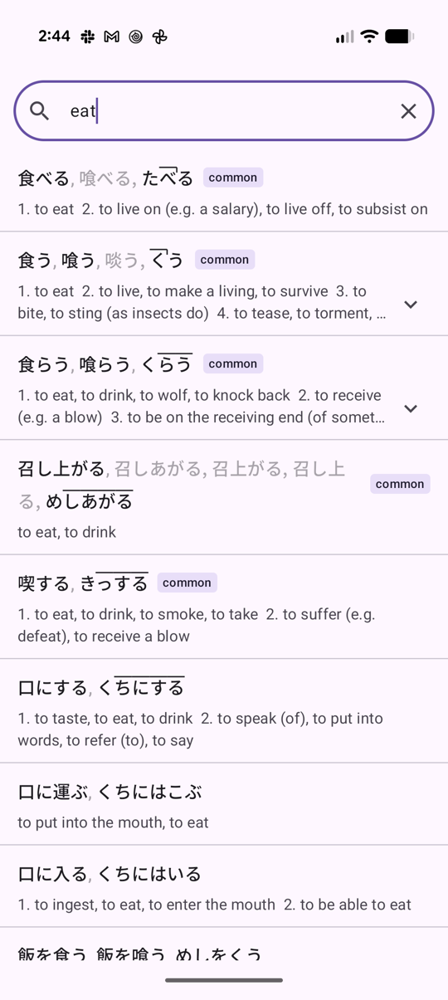
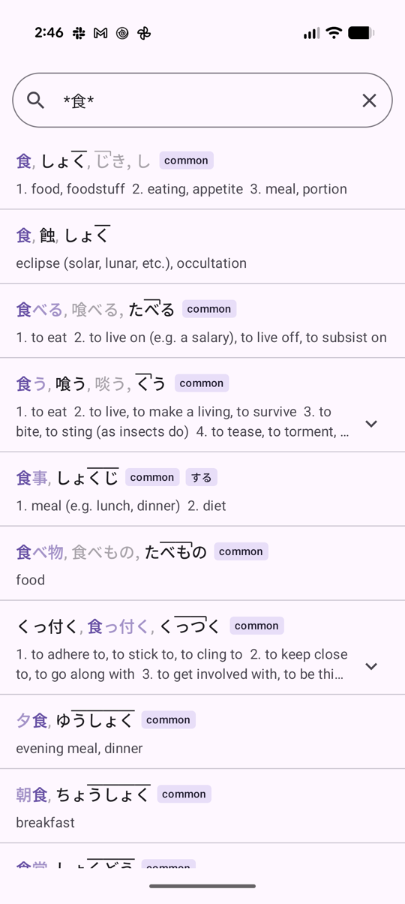
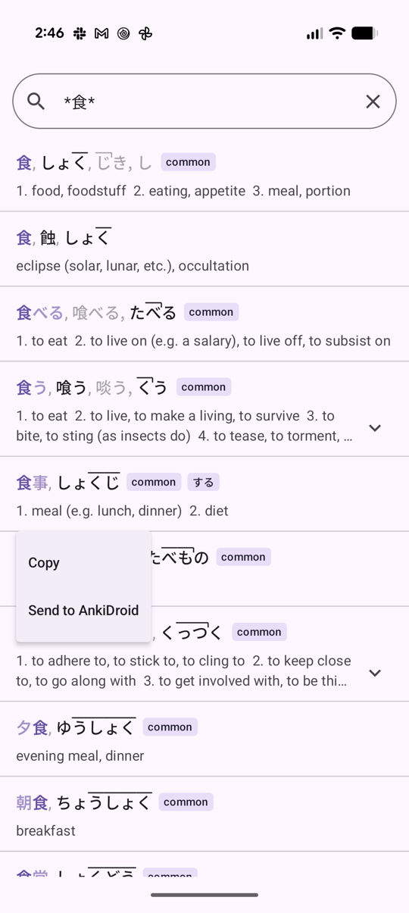
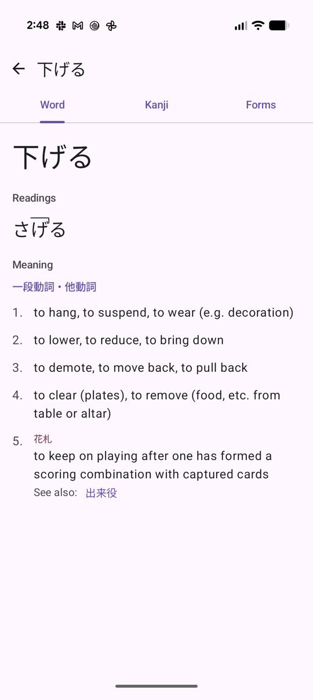
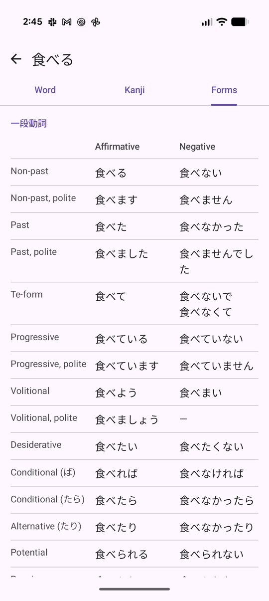
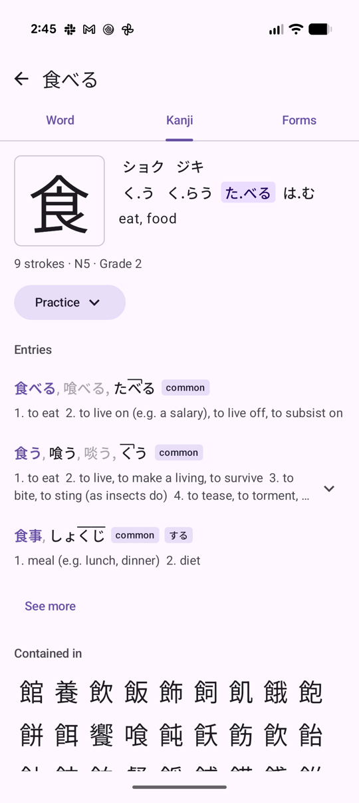
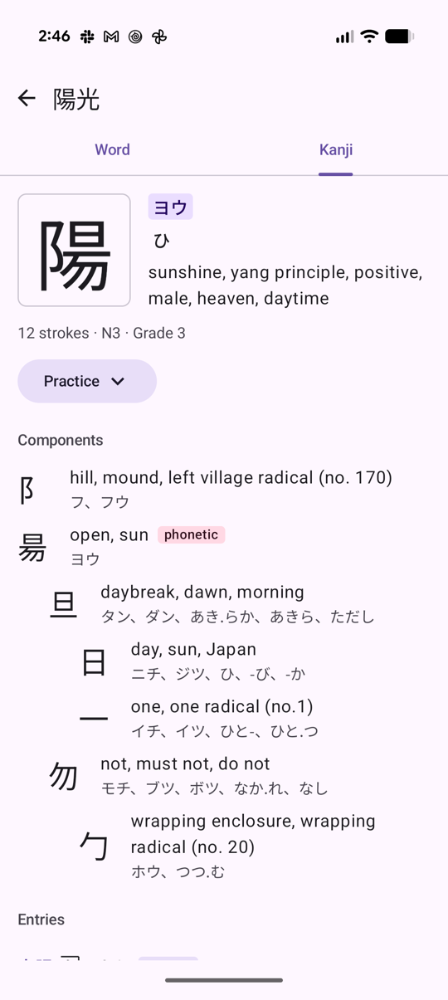
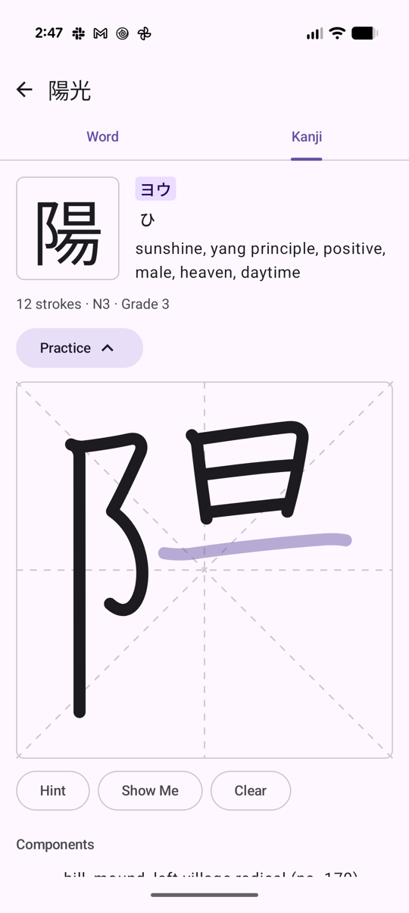
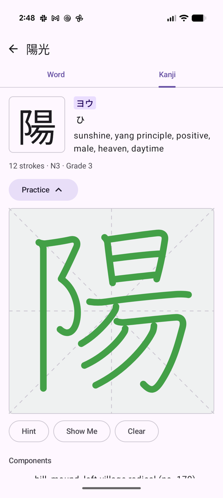

# 豆字引 (mamejibiki)

*"Bean-sized dictionary"*: a small, fully offline Japanese–English dictionary for Android. It's built for one learner's study routine. It combines a [Takoboto](https://takoboto.jp/)-style dictionary with jisho.org-style conjugation tables, KanjiVG component breakdowns, kakimashou-style stroke practice, and one-tap export to AnkiDroid.

It's written in Kotlin with Jetpack Compose. The dictionary data is built ahead of time into one SQLite file that ships inside the APK, so the app never touches the network.

The app was vibecoded with Claude: the owner tested every feature on their phone, and an AI agent wrote the code against the spec in [`plans/`](plans/).

## Screenshots

| Search (English) | Wildcard search | Long-press menu |
|---|---|---|
|  |  |  |
| **Word tab** | **Forms tab** | **Kanji tab** |
|  |  |  |
| **Component tree** | **Stroke practice, with a hint** | **Stroke practice, finished** |
|  |  |  |

## Features and user's manual

### Search

The app opens straight into the search field with the keyboard up. Results update as you type, including kana that the Japanese keyboard hasn't converted yet.

- **Japanese or English:** type kanji, kana or English. Any query without Japanese characters searches the English glosses. There's no romaji input, so `taberu` is treated as English.
- **Prefix matching:** ゆううつ also finds ゆううつしょう, and 憂鬱 also finds 憂鬱症.
- **Forgiving readings:** small slips in long vowels and voicing still match. ゆき finds 勇気 (ゆうき), コヒー finds コーヒー, and つ/づ, し/じ, は/ば/ぱ count as the same.
- **Conjugated words:** 食べられなかった finds 食べる, and the row is labelled "potential or passive, past, negative". 勉強した finds 勉強.
- **Wildcards** (Japanese queries; full-width `？` and `＊` work too):
  - `?` matches exactly one character: `日?`, `??語`.
  - `*` matches any run of characters. `*食` finds words ending in 食 (夕食, 朝食…), `*食*` finds words containing 食, and `食*会` finds words that start with 食 and end with 会.
- **Ranking:** exact matches come first, then whole-word fuzzy matches, then conjugated-form matches, then prefix matches. Within each group, common and frequent words come first (by the JPDB frequency list).
- **Paste and clear:** with the field empty, the clipboard button pastes and searches. Otherwise the ✕ clears the field.

### Result rows

- The first line shows every spelling and reading. **The one you matched is highlighted.** For a prefix match, the rest of the word is a lighter shade. Rare or irregular spellings are greyed out.
- Readings show **pitch accent**: an overline over the high morae, with a tick where the pitch drops.
- **common** and **する** badges.
- Senses are numbered and collapsed to two lines. Tap the chevron to expand a row, and tap it again to collapse it.
- **Tap** a row to open the word.
- **Long-press** a row for:
  - **Copy:** copies the spelling you matched.
  - **Send to AnkiDroid** (see below), or a greyed-out **Exists in AnkiDroid** when the word is already in your collection.

### Word page

The top bar shows the word you searched for. Below it are up to three tabs:

- **Word:** the headword in large type, other spellings (rare ones greyed out, with the reason), each reading with every pitch-accent pattern, and the senses.
  - Senses are grouped by part of speech under Japanese grammar labels such as 一段動詞・他動詞 or 名詞・自動詞（する）.
  - Each sense shows its own usage labels, notes and tappable **See also** / antonym links. A link opens a search for that word.
- **Kanji** (when the word has kanji): one block per kanji, described below.
- **Forms** (when the word conjugates): a table of affirmative and negative forms for verbs (20 inflections, from non-past to causative passive and imperative) and i-adjectives. The forms are spelled the way you searched (掛けた, not かけた). Irregular verbs (する, 来る, 行く, ある, くださる…) and いい are handled.

### Kanji blocks

Each kanji on the Kanji tab, or on a standalone kanji page, shows:

1. **Header:** the kanji in three tiles, in a sans-serif font, a serif font and KanjiVG's handwritten pen strokes (the shapes the practice canvas expects), then ON readings, KUN readings and English meanings. On a word's Kanji tab, **the reading the word uses is highlighted** (e.g. た.べる for 食べる). Below are the stroke count, JLPT level and school grade.
2. **Practice:** a button that opens a writing canvas. Draw each stroke in order with your finger:
   - A correct stroke snaps into its proper shape.
   - A wrong stroke flashes red and disappears.
   - A stroke that's acceptable but sloppy turns yellow.
   - **Hint** shows the next stroke faintly. **Show Me** writes all the remaining strokes out. **Clear** starts over.
   - When you finish, the canvas turns green for a clean run, yellow if you made a few mistakes, and red after three or more misses or after using Show Me.
3. **Components:** the kanji's building blocks as an indented tree, from KanjiVG. Each part shows its meanings and readings, and the phonetic component is marked. Tap any part to open its own kanji page.
4. **Entries:** the three most common words written with this kanji. **See more** searches `*<kanji>*` to list all of them.
5. **Contained in:** kanji that use this one as a component, most frequent first. **More** shows all of them. Tap one to open it.

Tap any of the three tiles to collapse the block to its header. **Long-press** any kanji in a block (a tile, a component or a Contained in kanji) and choose **Copy** to copy that character. It's an easy way to get radicals and components such as ⻖ that the keyboard can't reach.

### Navigation

Back (the ← arrow or the system gesture) steps through everything you've opened: searches, words, kanji pages and See also links. Each screen comes back exactly as you left it, with the same query, scroll position, tab, expanded rows and open practice canvases. Back from the first search screen closes the app.

### Send to AnkiDroid

Long-press a result and choose **Send to AnkiDroid** to add the word as a note. The first time, Android asks for AnkiDroid's database permission. A snackbar confirms "Added 〜 to 色んな言葉", or says the word is already in Anki.

The app knows which words you already have: whenever it comes to the foreground, it reads every Kaishi 1.5k note in AnkiDroid (in any deck) in the background. A note counts as the same word when its reading matches and its Word is any spelling of the word, ignoring `<ruby>` furigana, stray HTML, spaces, `(する)` and `〜` marks. For example, a つまらない note saved as `<ruby>詰<rt>つ</rt></ruby>まらない` counts. Words you send are added to that list straight away.

The note fills Word, Word Reading, Word Meaning, grammar Notes (in Japanese), Pitch Accent (as HTML) and Frequency (the JPDB rank). It's tagged so the owner's [anki-scripts](https://github.com/amacdougall/anki-scripts) skip the steps already done. Furigana, sentences, audio and the picture are left for those scripts to add.

> **The connection is hardcoded** to the owner's setup: note type **Kaishi 1.5k** (14 fields in a fixed order) and deck **色んな言葉**. If either is missing, the send fails with a message. To use a different deck, change `DECK` in `app/src/main/java/com/alanmacdougall/mamejibiki/anki/AnkiDroid.kt`. Any other note type needs code changes in `anki/Kaishi.kt`.

### Not included

The app has no favourites, word lists, quizzes, radical search, example sentences, text-to-speech, romaji input or settings screen.

## Getting started

This section is written for an AI coding agent setting the project up on a new machine. The owner's own toolchain notes are in [`plans/2026-10-26-dev-environment.md`](plans/2026-10-26-dev-environment.md).

### Read first

- [`CLAUDE.md`](CLAUDE.md): working rules for agents (commit policy, how to write plan docs).
- [`plans/progress.md`](plans/progress.md): what's built, known issues, and a log of each work session.
- [`plans/2026-10-26-ui-notes.md`](plans/2026-10-26-ui-notes.md): the full behaviour spec. Section numbers (§2, §5…) are cited throughout the code.
- [`plans/architecture.md`](plans/architecture.md): the code map, the back stack and screen state, and the database threading rules.
- [`plans/2026-10-26-feature-research.md`](plans/2026-10-26-feature-research.md): how the AnkiDroid API, KanjiVG trees and stroke matching work.
- [`pipeline/README.md`](pipeline/README.md): the data sources, the database schema and the entry JSON shape.

### Repository layout

| Path | Contents |
|---|---|
| `app/` | The Android app. Source is in `app/src/main/java/com/alanmacdougall/mamejibiki/`, and JVM unit tests are in `app/src/test/`. |
| `pipeline/` | A Ruby program that downloads the datasets and builds `app/src/main/assets/mamejibiki.sqlite`. |
| `shared/` | Test vectors (kana and English normalization, Anki fields) that both the Ruby and the Kotlin tests check. |
| `plans/` | The spec and the progress log. |
| `docs/screenshots/` | The images in this README. |

### 1. Install the toolchain

This project builds from the command line. Android Studio isn't needed. These steps assume macOS with Homebrew. On other platforms, install the same versions.

- **JDK 21:** `brew install openjdk@21`.
- **Android SDK:** install the command-line tools (`brew install --cask android-commandlinetools`, or Google's zip), then:
  ```sh
  sdkmanager "platform-tools" "platforms;android-37.0" "build-tools;37.0.0"
  ```
- **Ruby 3.4.11 with Bundler** for the data pipeline. The version is pinned in `pipeline/.ruby-version`, and rbenv picks it up. The `sqlite3` gem compiles a native extension.
- **Gradle** comes with the wrapper (`./gradlew`, version 9.8.2). Nothing else needs installing.

The build expects these variables. Set them in each shell command, because the owner's profile doesn't:

```sh
export JAVA_HOME=/opt/homebrew/opt/openjdk@21
export ANDROID_HOME=$HOME/Library/Android/sdk
export PATH=$JAVA_HOME/bin:$ANDROID_HOME/platform-tools:$ANDROID_HOME/cmdline-tools/latest/bin:$PATH
```

Create `local.properties` (it's gitignored) in the repo root:

```properties
sdk.dir=/Users/<you>/Library/Android/sdk
```

### 2. Build the dictionary database

**A fresh clone doesn't include the database.** The source datasets (`pipeline/data/`) and the built database (`app/src/main/assets/mamejibiki.sqlite`, about 146 MB) are gitignored. Build them before the first app build:

```sh
cd pipeline
bundle install
bundle exec ruby build.rb        # downloads the datasets into pipeline/data/, builds, copies into app assets (~30 s plus downloads)
bundle exec ruby query.rb 食べ    # optional: run the app's search tiers against the database
```

`build.rb` downloads the latest JMdict, KANJIDIC2, KanjiVG and JmdictFurigana releases from GitHub, plus pinned copies of the JPDB frequency list, the Wadoku pitch database and the JLPT levels (checked by SHA-256). It stops with an error if JMdict contains a grammar tag that `pipeline/grammar_labels.tsv` doesn't cover. If that happens, add a line for the new tag to the TSV.

Rerun `build.rb` only when the schema or a dataset changes. `--refresh` re-downloads the datasets that are fetched as latest releases.

### 3. Build and install the app

You need an Android 13+ device (minSdk 33) with USB or wireless debugging on. To use wireless debugging, pair once with `adb pair <ip>:<port>` (the phone shows the address and code under Developer options → Wireless debugging). After that, adb usually finds the phone by mDNS.

```sh
./gradlew assembleDebug
adb install -r app/build/outputs/apk/debug/app-debug.apk     # ~70 MB, mostly the compressed database
adb shell am start -W -n com.alanmacdougall.mamejibiki/.MainActivity
```

On first launch, the app copies the database out of the APK into its own storage and shows "Preparing dictionary…" for a few seconds. It copies again whenever `app/src/main/assets/mamejibiki.version` changes.

There's no release signing or Play Store build. Debug builds use the auto-generated debug key, and Play Protect may flag the sideloaded APK as harmful. The app still runs.

### 4. Run the tests

```sh
./gradlew testDebugUnitTest                                                        # Kotlin, on the JVM
cd pipeline && bundle exec ruby -Itest -e 'Dir["test/*_test.rb"].each { |f| require_relative f }'   # Ruby
```

The Kotlin tests cover normalization, wildcards, pitch parsing, conjugation and deinflection, kanji ordering and reading highlights, stroke scoring, and the Anki fields. They're plain JVM tests and can't use Android classes or the database, so code that needs testing is kept free of Android dependencies.

`KaishiTest` checks the app against `shared/anki-vectors.json`. That file is generated by `pipeline/anki_vectors.rb` using the code in [anki-scripts](https://github.com/amacdougall/anki-scripts), which must be checked out next to this repo at `../anki-scripts`. Regenerate the file only after a database rebuild or an anki-scripts format change. The committed copy works without anki-scripts.

### 5. Check your changes on a device

The owner doesn't read the code, so screenshots from the device are the main check. This loop works:

```sh
adb shell dumpsys window | grep mCurrentFocus      # make sure the app is in the foreground before sending input
adb shell input text "to%sstand"                   # ASCII only; %s is a space
adb shell input tap X Y                            # screen coordinates are 1080 px wide on the owner's Pixel
adb shell uiautomator dump /sdcard/ui.xml && adb exec-out cat /sdcard/ui.xml   # element bounds
adb exec-out screencap -p > shot.png
adb logcat -s Search:I AndroidRuntime:E           # search timings and crashes; read it right away, the buffer rolls over
```

Limitations and workarounds:

- `adb shell input text` can't type Japanese. Reach Japanese screens through English searches, See also links, or a kanji block's See more. Check search tiers with `pipeline/query.rb`, or ask a human to type on the phone.
- The practice canvas can be driven with `adb shell input motionevent DOWN/MOVE/UP`, using stroke paths from the `kanji_vg` table. The canvas maps KanjiVG's 109-unit square onto its on-screen bounds.
- `adb shell cmd uimode night yes|no` switches dark mode. Read the current value first and restore it afterwards.

### Conventions

- Commit directly to `main`, and only when the owner asks.
- Keep `plans/` describing current decisions only. Update `plans/progress.md` at the end of every work session.
- Text containing Japanese is tagged with the `ja` locale, so kanji render in their Japanese forms rather than Chinese ones.

## Data sources and credits

| Dataset | Used for |
|---|---|
| [JMdict](https://www.edrdg.org/jmdict/j_jmdict.html) via [jmdict-simplified](https://github.com/scriptin/jmdict-simplified) | Entries, readings, senses, cross-references |
| [KANJIDIC2](https://www.edrdg.org/wiki/index.php/KANJIDIC_Project) via jmdict-simplified | Kanji readings, meanings, grades, stroke counts |
| [KanjiVG](https://kanjivg.tagaini.net/) | Component trees and stroke paths |
| [JmdictFurigana](https://github.com/Doublevil/JmdictFurigana) | Per-kanji reading alignment |
| [Wadoku](https://www.wadoku.de/) pitch data, via [IllDepence/anki_add_pitch_plugin](https://github.com/IllDepence/anki_add_pitch_plugin) | Pitch accent |
| JPDB v2.2 frequency list, via [Kuuuube/yomitan-dictionaries](https://github.com/Kuuuube/yomitan-dictionaries) | Ranking and the Anki Frequency field |
| [davidluzgouveia/kanji-data](https://github.com/davidluzgouveia/kanji-data) | JLPT N1–N5 levels |

JMdict and KANJIDIC2 belong to the [Electronic Dictionary Research and Development Group](https://www.edrdg.org/) and are used under its licence (CC BY-SA 4.0). KanjiVG is © Ulrich Apel, licensed under CC BY-SA 3.0. The other datasets keep their own licences. None of the data is committed to this repository: the pipeline downloads it.
